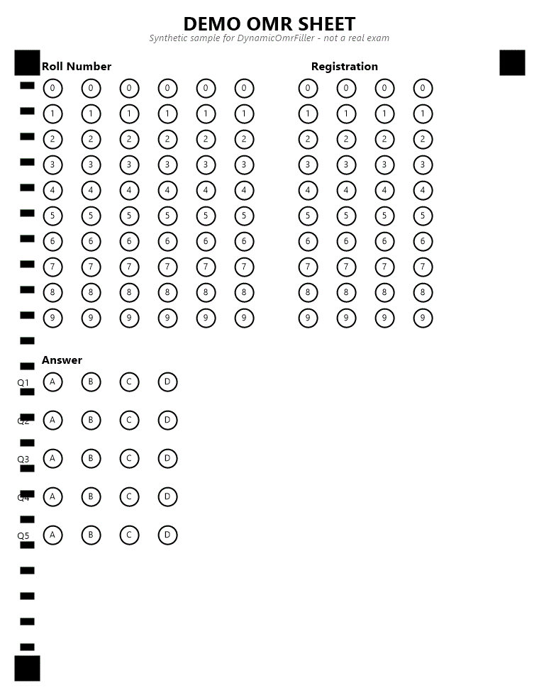
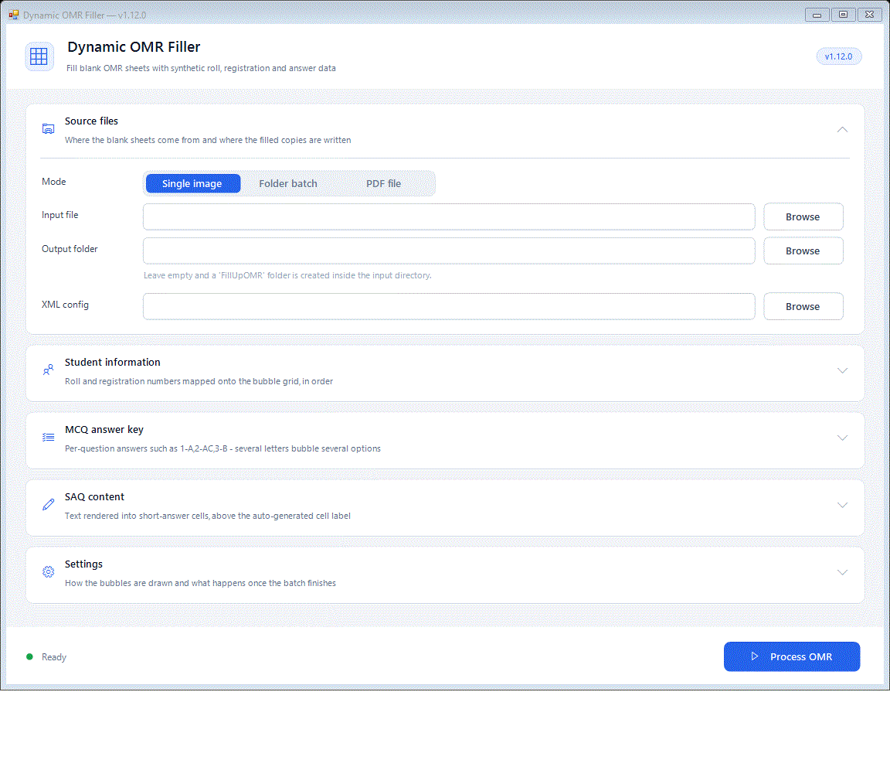

# DynamicOmrFiller

**A Windows desktop tool that automatically fills blank scanned OMR answer sheets with synthetic data** — roll numbers, registration numbers, MCQ answers, SAQ text, and "question quality" bubbles — so you can QA an OMR scoring pipeline without hand-filling hundreds of physical sheets.

It reads a real scanned image (or a PDF), locates the bubble grid from the sheet's fiducial markers, and draws filled dots on top of the correct bubbles according to an XML layout description.

## About

Automated test-prep and admission platforms generate thousands of OMR answer sheets. Before those sheets ever reach a scanner, someone has to prove the *scoring* pipeline reads them correctly — and that means producing sheets with known, verifiable answers at scale. DynamicOmrFiller exists for exactly that: point it at a blank sheet (or a folder of them, or a PDF with mixed question/answer pages) and an XML config that describes where the bubbles are, and it hands back filled copies plus a CSV of exactly what it filled in, ready to feed into a scoring system for verification.

It's a self-contained WinForms app — no external services, no NuGet packages for the core logic, and PDF support comes from the PDF engine already built into Windows. Everything it needs ships in one `.exe`.

## See it in action

**Filling a sheet** — the engine detects the grid from the corner markers and bubbles in the roll number, registration number, and MCQ answers:



**The app itself** — single image, folder batch, or PDF input; student roll/registration lists; a per-question MCQ answer key; and settings for how the bubbles get drawn:



## Features

- **Three input modes** — a single image, a folder of images, or a PDF (rendered page-by-page at 300 dpi using the Windows PDF engine, no SDK or NuGet required). Pages that don't match the configured OMR design are skipped automatically instead of being drawn on incorrectly.
- **Automatic grid detection** from corner fiducial markers and a timing-mark column, including half-page OMR layouts where the bubble sheet occupies only part of a page.
- **MCQ answer key** with per-question control — `1-A,2-AC,3-B,4-ABCD` lets a single question carry multiple marked options, blank entries leave a question deliberately unanswered, and anything not listed can be filled randomly or left blank.
- **Answer-key CSV export** — a ground-truth record of exactly what was filled into each sheet, for checking a scoring pipeline's output against.
- **Roll/registration bulk import** from Excel or CSV, with a column picker so any header naming works, not just the ones the auto-matcher can guess.
- **SAQ (short-answer) text placement** — font size, label size, and text alignment are all configurable, so the same written sample text can be dropped into any sheet's answer boxes.
- **Saved defaults** — roll/registration lists and SAQ settings can be saved and are restored on the next launch.
- **PDF output cropping** — when filling from a PDF, the output can be trimmed to just the OMR sheet area, dropping the question-paper half of a page.

## Download

Grab the latest build from **[Releases](../../releases/latest)** — download the zip, extract it, and run `DynamicOmrFiller.exe`. Requires .NET Framework 4.7.2 (already installed on current Windows); nothing else to set up.

## Building from source

```
MSBuild DynamicOmrFiller.csproj -t:Rebuild -p:Configuration=Release -v:minimal
```

Open `DynamicOmrFiller.sln` in Visual Studio 2022 and press F5 to run it from source instead.

## How it works, and how to extend it

**[PROJECT.md](PROJECT.md)** is the full reference: the processing pipeline (grid detection → page-ID detection → roll/registration cycling → region rendering), the XML configuration format, the UI architecture, and a guide to adding new region types or file formats. Start there before making changes.
